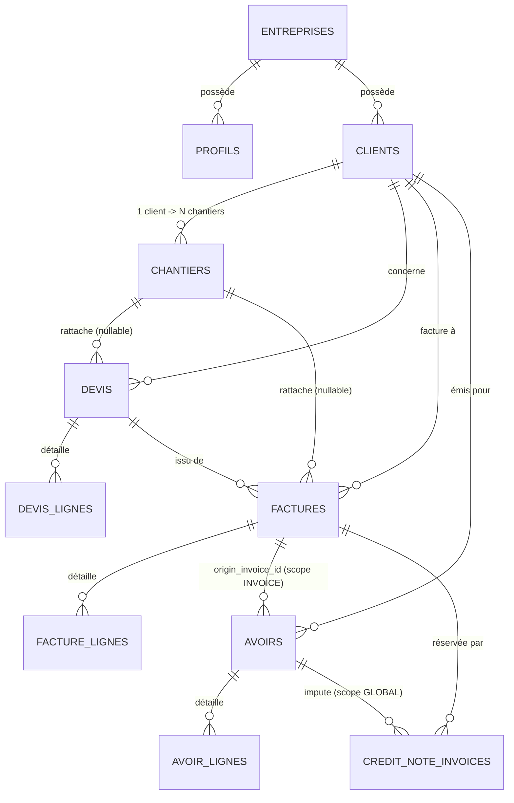

# MISSION CODEX — RAPPORT D'AUDIT TECHNIQUE PRÉALABLE
## Refonte Fonctionnelle & Financière BNA-App

> [!IMPORTANT]
> **Statut de l'audit** : Strictement en lecture seule. Aucune modification de code, aucune migration et aucune altération de données n'ont été effectuées sur le dépôt ou sur la base distante Supabase.

---

## 1. État Réel de l'Existant

L'application BNA-App est une Single Page Application (SPA) bâtie sur Next.js 15 (App Router) et React 18, connectée à Supabase (PostgreSQL 15 avec Row Level Security et multi-tenant par entreprise).

### 1.1 Architecture Applicative et Routage
- **Route principale unique** : [`src/app/page.tsx`](file:///data/data/com.termux/files/home/Bna-app/src/app/page.tsx#L32-L370). L'ensemble de la navigation est géré par un état local React (`currentTab` : `"accueil"`, `"terrain"`, `"cockpit"`, `"chantiers"`, `"devis"`, `"assistant"`).
- **Navigation mobile et desktop** : [`src/components/navigation/BottomNav.tsx`](file:///data/data/com.termux/files/home/Bna-app/src/components/navigation/BottomNav.tsx#L13-L20) propose 5 onglets fixes (`Accueil`, `Terrain`, `Chantiers`, `Devis`, `Assistant`) plus un bouton central flottant d'action rapide sur mobile, et une barre supérieure horizontale sur desktop.
- **Écrans autonomes** :
  - **Accueil** : [`WeatherCard`](file:///data/data/com.termux/files/home/Bna-app/src/components/dashboard/WeatherCard.tsx), [`PlanningCard`](file:///data/data/com.termux/files/home/Bna-app/src/components/dashboard/PlanningCard.tsx), [`FeaturedProjectCard`](file:///data/data/com.termux/files/home/Bna-app/src/components/dashboard/FeaturedProjectCard.tsx), [`RiskProjectsCard`](file:///data/data/com.termux/files/home/Bna-app/src/components/dashboard/RiskProjectsCard.tsx).
  - **Cockpit** : [`src/components/screens/CockpitScreen.tsx`](file:///data/data/com.termux/files/home/Bna-app/src/components/screens/CockpitScreen.tsx#L46-L536), centré sur un chantier actif unique sélectionné, affichant l'avancement, les matériaux, la météo, le planning, les photos et les PV/SAV.
  - **Terrain** : [`src/components/screens/TerrainScreen.tsx`](file:///data/data/com.termux/files/home/Bna-app/src/components/screens/TerrainScreen.tsx#L23-L195), centré sur les saisies mobiles d'un chantier actif (photos, notes, calepinage, cockpit).
  - **Chantiers / Clients** : Sous-onglets gérés dans [`src/app/page.tsx`](file:///data/data/com.termux/files/home/Bna-app/src/app/page.tsx#L225-L330) avec [`ClientsScreen.tsx`](file:///data/data/com.termux/files/home/Bna-app/src/components/clients/ClientsScreen.tsx).
  - **Devis & Finance** : [`src/components/screens/DevisFinanceScreen.tsx`](file:///data/data/com.termux/files/home/Bna-app/src/components/screens/DevisFinanceScreen.tsx#L40-L1400), gérant la liste des devis et des factures pour l'ensemble de l'entreprise.

---

## 2. Fichiers et Composants Concernés

| Domaine | Fichiers clés | Rôle actuel |
| :--- | :--- | :--- |
| **Navigation** | [`src/components/navigation/BottomNav.tsx`](file:///data/data/com.termux/files/home/Bna-app/src/components/navigation/BottomNav.tsx) <br> [`src/app/page.tsx`](file:///data/data/com.termux/files/home/Bna-app/src/app/page.tsx) | Définition des onglets `NAV_ITEMS`, état `currentTab`, conteneurs de rendu |
| **Cockpit / Terrain** | [`src/components/screens/CockpitScreen.tsx`](file:///data/data/com.termux/files/home/Bna-app/src/components/screens/CockpitScreen.tsx) <br> [`src/components/screens/TerrainScreen.tsx`](file:///data/data/com.termux/files/home/Bna-app/src/components/screens/TerrainScreen.tsx) <br> [`src/components/chantiers/ChantierCard.tsx`](file:///data/data/com.termux/files/home/Bna-app/src/components/chantiers/ChantierCard.tsx) | Suivi de l'avancement, météo chantier, matériaux à commander, planning |
| **Clients & Contacts** | [`src/components/clients/ClientsScreen.tsx`](file:///data/data/com.termux/files/home/Bna-app/src/components/clients/ClientsScreen.tsx) <br> [`src/components/clients/ClientDetailModal.tsx`](file:///data/data/com.termux/files/home/Bna-app/src/components/clients/ClientDetailModal.tsx) <br> [`src/lib/services/clientService.ts`](file:///data/data/com.termux/files/home/Bna-app/src/lib/services/clientService.ts) | Gestion 1 Client → N Chantiers, contacts secondaires, coordonnées |
| **Facturation & Devis** | [`src/components/screens/DevisFinanceScreen.tsx`](file:///data/data/com.termux/files/home/Bna-app/src/components/screens/DevisFinanceScreen.tsx) <br> [`src/components/finance/DevisPrintModal.tsx`](file:///data/data/com.termux/files/home/Bna-app/src/components/finance/DevisPrintModal.tsx) <br> [`src/lib/services/devisFinanceService.ts`](file:///data/data/com.termux/files/home/Bna-app/src/lib/services/devisFinanceService.ts) | Création et listing des devis, émission d'acomptes/situations/soldes, bilan financier |
| **Moteur Financier** | [`src/lib/documents/documentCalculs.ts`](file:///data/data/com.termux/files/home/Bna-app/src/lib/documents/documentCalculs.ts) <br> [`src/lib/documents/documentTypes.ts`](file:///data/data/com.termux/files/home/Bna-app/src/lib/documents/documentTypes.ts) | Calculs déterministes d'arrondi, multi-TVA, réconciliation solde, imputation d'avoirs |
| **Calepinage** | [`src/components/calepinage/TerrasseCalepinagePanel.tsx`](file:///data/data/com.termux/files/home/Bna-app/src/components/calepinage/TerrasseCalepinagePanel.tsx) <br> [`src/components/calepinage/BardageCalepinagePanel.tsx`](file:///data/data/com.termux/files/home/Bna-app/src/components/calepinage/BardageCalepinagePanel.tsx) <br> [`src/components/calepinage/ClotureCalepinagePanel.tsx`](file:///data/data/com.termux/files/home/Bna-app/src/components/calepinage/ClotureCalepinagePanel.tsx) | Moteurs 2D/3D et calcul des quantitatifs matériaux selon DTU 51.4 et 41.2 |
| **Météo / Intempéries** | [`src/lib/services/meteoFranceService.ts`](file:///data/data/com.termux/files/home/Bna-app/src/lib/services/meteoFranceService.ts) <br> [`src/components/weather/AttestationIntemperieModal.tsx`](file:///data/data/com.termux/files/home/Bna-app/src/components/weather/AttestationIntemperieModal.tsx) | Données Météo France, alertes vent/pluie/gel, attestation d'arrêt de chantier |

---

## 3. Tables et Relations Supabase Concernées

L'architecture SQL s'articule autour des migrations [`20261029000001_socle_entreprises_profils.sql`](file:///data/data/com.termux/files/home/Bna-app/supabase/migrations/20261029000001_socle_entreprises_profils.sql), [`20261029000002_clients_chantiers.sql`](file:///data/data/com.termux/files/home/Bna-app/supabase/migrations/20261029000002_clients_chantiers.sql) et [`20261105101502_socle_financier_phase1.sql`](file:///data/data/com.termux/files/home/Bna-app/supabase/migrations/20261105101502_socle_financier_phase1.sql).



### 3.1 Détail des Contraintes et Clés Étrangères
1. **`clients`** : Clé primaire `id uuid`, clé unique composite `(id, entreprise_id)`.
2. **`chantiers`** : `client_id uuid NOT NULL`, clé étrangère composite `fk_chantiers_client FOREIGN KEY (client_id, entreprise_id) REFERENCES public.clients(id, entreprise_id)`. Clé unique composite `uq_chantiers_id_entreprise_client UNIQUE (id, entreprise_id, client_id)`.
3. **`devis`** : Clé étrangère composite `(client_id, entreprise_id)` vers `clients` et `(chantier_id, entreprise_id, client_id)` vers `chantiers`. `chantier_id` est nullable. Statuts : `BROUILLON`, `ENVOYE`, `SIGNE`, `REFUSE`, `ANNULE`.
4. **`factures`** : Clé étrangère composite vers `clients`, `devis` et `chantiers`. `type IN ('ACOMPTE', 'SITUATION', 'SOLDE', 'DIRECTE')`. Statuts : `BROUILLON`, `EMISE`, `PARTIELLEMENT_PAYEE`, `PAYEE`, `ANNULEE`.
5. **`avoirs`** :
   - `client_id uuid NOT NULL`.
   - `scope text CHECK (scope IN ('INVOICE','GLOBAL'))`.
   - `origin_invoice_id uuid` (uniquement si `scope = 'INVOICE'`).
   - `statut CHECK (statut IN ('BROUILLON','EMIS','ANNULE'))`.
   - > [!WARNING]
     > **Absence de `chantier_id` sur la table `avoirs`** : La table `public.avoirs` ([migration L144-L181](file:///data/data/com.termux/files/home/Bna-app/supabase/migrations/20261105101502_socle_financier_phase1.sql#L144-L181)) n'a **aucune colonne `chantier_id`**. Le chantier d'un avoir de scope `INVOICE` ne peut être déduit qu'indirectement via `factures.chantier_id`. Pour un avoir `GLOBAL`, le lien avec le chantier est inexistant en base.
6. **`credit_note_invoices`** :
   - Clé primaire `(credit_note_id, invoice_id)`.
   - `CONSTRAINT uq_credit_note_invoice_reserved UNIQUE (invoice_id)` : impose qu'une facture ne puisse figurer qu'une seule fois dans la table de réservation d'avoirs globaux.
   - Ne contient **aucune colonne de montant imputé** (`montant_impute_ttc`).

---

## 4. Fonctionnalités Déjà Disponibles

1. **Relation 1 Client → N Chantiers** :
   - Intégralement gérée en base (`fk_chantiers_client`) et dans l'interface ([`ClientDetailModal.tsx` L402-L448](file:///data/data/com.termux/files/home/Bna-app/src/components/clients/ClientDetailModal.tsx#L402-L448)).
2. **Cycle Devis → Acompte / Situation / Solde** :
   - La RPC `emettre_facture_financiere` ([migration L381-L434](file:///data/data/com.termux/files/home/Bna-app/supabase/migrations/20261105101502_socle_financier_phase1.sql#L381-L434)) et la fonction [`creerFactureDepuisDevis`](file:///data/data/com.termux/files/home/Bna-app/src/lib/services/devisFinanceService.ts#L661-L731) calculent automatiquement les lignes restantes à facturer et appliquent la retenue de garantie légale (0 à 5 %).
3. **Immutabilité des pièces émises** :
   - Fonction trigger PostgreSQL `proteger_document_financier_emis()` interdisant l'altération ou la suppression de devis signés, de factures émises et d'avoirs émis.
4. **Calculs déterministes d'arrondi et multi-TVA** :
   - Module mathématique pur [`src/lib/documents/documentCalculs.ts`](file:///data/data/com.termux/files/home/Bna-app/src/lib/documents/documentCalculs.ts) avec gestion des taux 20 %, 10 %, 5.5 %, 0 %, règle des demi-centimes au centime supérieur et ventilation sans ligne négative.
5. **Algorithme d'imputation anti-double déduction** :
   - [`imputerSurFacture()`](file:///data/data/com.termux/files/home/Bna-app/src/lib/documents/documentCalculs.ts#L1058-L1183) contrôle le reste exigible d'une facture et la provision restante d'un avoir ou d'un règlement.
6. **Météo, Vigilances et Attestation Intempérie** :
   - Connecteur direct Météo France et génération d'attestations d'arrêt de chantier conforme aux règles de l'art du BTP.
7. **Calepinage métier 2D/3D & Besoins matières** :
   - Calcul des surfaces, lambourdes, plots, vis, lames, pare-pluie selon DTU 51.4 et DTU 41.2 avec sauvegarde versionnée dans Supabase.

---

## 5. Modifications Nécessaires

### 5.1 Nouvelle Règle d'Éligibilité aux Situations (21 Jours Ouvrés)
- **Constat d'absence totale** : Le terme "férié" n'apparaît nulle part dans le projet. Dans [`DevisFinanceScreen.tsx` L706](file:///data/data/com.termux/files/home/Bna-app/src/components/screens/DevisFinanceScreen.tsx#L706) et [`devisFinanceService.ts` L661](file:///data/data/com.termux/files/home/Bna-app/src/lib/services/devisFinanceService.ts#L661), l'émission d'une situation est instantanée sans aucun contrôle calendaire.
- **Nécessité** :
  1. Implémenter un calculateur déterministe hors-ligne des 11 jours fériés français (calcul de Pâques selon l'algorithme de Butcher/Meeus + dates fixes du 1er janvier, 1er mai, 8 mai, 14 juillet, 15 août, 1er novembre, 11 novembre, 25 décembre).
  2. Implémenter une fonction `calculerJoursOuvres(dateDebut: Date, dateFin: Date): number` ignorant samedis, dimanches et fériés.
  3. Conditionner l'activation du bouton « + Facture Situation » à l'atteinte de 21 jours ouvrés révolus (ou afficher un badge indicatif : « Éligible dans X jours ouvrés, le DD/MM »).

### 5.2 Raccordement de la Table `avoirs` aux Chantiers
- Pour respecter la règle « Ses documents restent rattachés à leur chantier d'origine », la table `public.avoirs` doit pouvoir stocker un `chantier_id` (clé étrangère optionnelle vers `public.chantiers`).
- L'écran financier doit intégrer l'onglet **Avoirs** (actuellement, [`DevisFinanceScreen.tsx`](file:///data/data/com.termux/files/home/Bna-app/src/components/screens/DevisFinanceScreen.tsx) ne propose que les sous-onglets `"devis"` et `"factures"`, alors que le service backend possède déjà `getAvoirsList` et `emettreAvoir`).

### 5.3 Encaissé TTC et Suivi des Règlements Réels
- **Constat** : Dans [`calculerBilanFinancierGlobal`](file:///data/data/com.termux/files/home/Bna-app/src/lib/services/devisFinanceService.ts#L847-L849) :
  ```ts
  if (f.statut === "payee") {
    encaisse_ttc = arrondirCentimes(encaisse_ttc + f.net_a_payer_ttc);
  }
  ```
  Le statut `PARTIELLEMENT_PAYEE` est ignoré, et aucun encaissement partiel ou échelonné n'est tracé car il n'existe pas de table `reglements` dans Supabase.
- **Nécessité** :
  Pour que « L'encaissé TTC correspond aux paiements réellement reçus », une table de règlements (`reglements` ou `paiements`) doit enregistrer chaque flux avec date, moyen de paiement et montant encaissé.

### 5.4 Refonte de la Navigation et Regroupement Cockpit
- **Structure actuelle** : `Accueil`, `Terrain`, `Chantiers`, `Devis`, `Assistant`.
- **Nouvelle structure fonctionnelle** :
  - **Cockpit unifié** : Fusion ou articulation claire entre Client (vue portefeuille / fiche client), Chantier (pilotage projet, jalons, matériaux) et Terrain (photos, notes vocales, relevés).
  - **Facturation** : Devis, Factures & Situations, Avoirs.
  - **Documents** : Vue consolidée multi-chantiers (devis, factures, situations, avoirs, PV, attestations météo).

---

## 6. Risques Techniques et Financiers

```
┌────────────────────────────────────────────────────────────────────────┐
│                        MATRICE DES RISQUES BNA                         │
├────────────────────────┬─────────────┬─────────────┬──────────────────┤
│ Risque identifié       │ Gravité     │ Probabilité │ Impact Métier    │
├────────────────────────┼─────────────┼─────────────┼──────────────────┤
│ Calcul Encaissé TTC    │ Élevée      │ Certaine    │ Trésorerie fausse│
│ Absence chantier avoir │ Moyenne     │ Élevée      │ Perte traçabilité│
│ Blocage 21j non cadré  │ Moyenne     │ Élevée      │ Litige facturation│
│ Imputation d'avoirs SQL│ Élevée      │ Moyenne     │ Rejet base PG    │
└────────────────────────┴─────────────┴─────────────┴──────────────────┘
```

1. **Risque financier (Encaissé TTC biaisé)** :
   Considérer qu'une facture est encaissée à 100 % dès qu'elle passe au statut `payee` fausse les indicateurs de trésorerie si un client règle par acomptes partiels ou par chèques échelonnés.
2. **Risque de blocage SQL sur les avoirs (`uq_credit_note_invoice_reserved`)** :
   La contrainte SQL actuelle dans `credit_note_invoices` interdit d'associer plus d'un avoir global à une même facture. Si un client bénéficie de deux avoirs successifs sur une même facture, PostgreSQL lèvera une erreur de clé unique (`23505`).
3. **Risque de désynchronisation de l'arrondi** :
   Une divergence d'arrondi est explicitement documentée entre [`devisFinanceService.ts` L25-L30](file:///data/data/com.termux/files/home/Bna-app/src/lib/documents/documentCalculs.ts#L25-L30) (arrondi standard `Math.round`) et [`documentCalculs.ts`](file:///data/data/com.termux/files/home/Bna-app/src/lib/documents/documentCalculs.ts) (arrondi déterministe `deplacerVirgule`). Une unification stricte est requise pour éviter un décalage d'un centime entre l'affichage et l'enregistrement comptable.
4. **Risque d'incompréhension sur la règle des 21 jours ouvrés** :
   Si la date de départ des 21 jours n'est pas clairement définie (ex: date de début réel du chantier vs date de signature devis vs date de situation précédente), cela peut bloquer prématurément ou indûment la facturation d'un artisan en fin de mois.

---

## 7. Incompatibilités Éventuelles avec l'Architecture Actuelle

1. **Table `avoirs` sans `chantier_id`** : Incompatible avec l'exigence « Ses documents restent rattachés à leur chantier d'origine ». Une migration SQL ajoutant `chantier_id uuid REFERENCES public.chantiers(id)` sera nécessaire.
2. **Contrainte `UNIQUE(invoice_id)` dans `credit_note_invoices`** : Incompatible avec la possibilité de ventiler plusieurs avoirs partiels sur une même facture.
3. **Absence de persistance des règlements réels** : Incompatible avec un calcul d'encaissé basé sur les flux financiers reçus.
4. **Isolation actuelle du Cockpit et du Terrain** :
   Dans l'architecture actuelle, `CockpitScreen` et `TerrainScreen` maintiennent des états séparés de chantier actif et des modales distinctes. Les regrouper sous un bouton unique nécessite d'introduire un sous-menu ou des onglets internes fluides (ex : Cockpit > [Clients | Chantiers | Terrain]).

---

## 8. Plan de Réalisation Proposé par Étapes

### Étape 1 : Moteur de Calendrier et Règle des 21 Jours Ouvrés
- Création d'un module pur `src/lib/calendar/joursOuvresService.ts` :
  - Calcul des jours fériés légaux français (algorithme de calcul de Pâques).
  - Décompte des jours ouvrés (du lundi au vendredi, hors fériés).
  - Tests unitaires automatisés validant les années 2024, 2025, 2026 et 2027.
- Intégration dans le contrôle d'éligibilité des situations dans [`devisFinanceService.ts`](file:///data/data/com.termux/files/home/Bna-app/src/lib/services/devisFinanceService.ts) et affichage du statut dans l'interface.

### Étape 2 : Évolution Schéma Supabase & Avoirs Multi-Factures
- Préparation de la migration SQL (non appliquée à ce stade) :
  - Ajout de `chantier_id` sur `public.avoirs`.
  - Assouplissement de `credit_note_invoices` pour permettre l'imputation partielle multi-avoirs avec montant imputé (`montant_impute_ttc`).
  - Création de la table `public.reglements` pour l'enregistrement des paiements réels.
- Branchement des fonctions `emettreAvoir` et `getAvoirsList` dans l'interface utilisateur.

### Étape 3 : Hub Documentaire Consolidé Multi-Chantiers
- Conception du composant centralisé `DocumentsHubScreen.tsx` :
  - Vue de synthèse multi-documents : Devis, Factures, Situations, Avoirs, PV de Réception, Attestations Intempéries.
  - Filtres par Client, par Chantier, par Type de document et par Période.
  - Garantie visuelle de l'affichage permanent du nom du client et du chantier rattaché.

### Étape 4 : Refonte de la Navigation Principale à 5 Boutons
- Mise à jour de [`BottomNav.tsx`](file:///data/data/com.termux/files/home/Bna-app/src/components/navigation/BottomNav.tsx) et [`src/app/page.tsx`](file:///data/data/com.termux/files/home/Bna-app/src/app/page.tsx) selon la grille fonctionnelle validée par le propriétaire :
  1. **Accueil** (Vue d'ensemble, alertes météo, jalons urgents).
  2. **Cockpit** (Onglets internes : Clients, Chantiers, Terrain).
  3. **Facturation** (Devis, Factures & Situations, Avoirs, Règlements).
  4. **Documents** (Répertoire global documentaire tous chantiers).
  5. **Assistant** (Intelligence métier, aide aux devis et DTU).
- Adaptation responsive mobile et desktop.

### Étape 5 : Unification des Calculs et Sécurisation des Tests
- Remplacement du calcul d'arrondi simplifié dans [`devisFinanceService.ts`](file:///data/data/com.termux/files/home/Bna-app/src/lib/services/devisFinanceService.ts) par le moteur certifié [`documentCalculs.ts`](file:///data/data/com.termux/files/home/Bna-app/src/lib/documents/documentCalculs.ts).
- Validation de la suite complète de tests de non-régression (`npx tsc --noEmit` et tests automatisés).

---

## 9. Points Nécessitant une Décision du Propriétaire

Avant d'entamer la moindre modification de code, **quatre arbitrages majeurs** doivent être tranchés par le propriétaire du projet :

### Décision 1 : Date de Référence pour les 21 Jours Ouvrés
Pour calculer l'éligibilité d'une situation d'avancement, quelle est la date de départ exacte ?
- **Option 1A** : La date de début des travaux du chantier (`chantier.date_debut_prevue` ou date réelle de premier coup de pioche / pose) pour la première situation, puis la date d'émission de la situation précédente pour les situations suivantes. *(Recommandé BTP)*
- **Option 1B** : La date de validation/signature du devis pour la première situation.
- **Option 1C** : La date de la facture d'acompte.

### Décision 2 : Ergonomie des 5 Boutons de Navigation Principale
Quelle configuration exacte privilégiez-vous pour la barre de navigation à 5 boutons ?
- **Option 2A (Recommandée)** :
  1. `Accueil`
  2. `Cockpit` (avec sélecteur interne [Clients / Chantiers / Terrain])
  3. `Facturation` (Devis, Factures & Situations, Avoirs)
  4. `Documents` (Hub global documentaire tous chantiers)
  5. `Assistant` (IA BNA)
- **Option 2B** :
  1. `Cockpit`
  2. `Terrain`
  3. `Facturation`
  4. `Documents`
  5. `Assistant`
  *(Dans ce cas, l'Accueil est absorbé dans le Cockpit).*

### Décision 3 : Périmètre du "Regroupement Global des Documents"
Quels types de pièces doivent figurer dans la vue documentaire globale ?
- **Option 3A (Financier uniquement)** : Devis, Factures d'acompte, Factures de situation, Factures de solde, Avoirs.
- **Option 3B (Tous documents chantier)** : Devis, Factures, Situations, Avoirs **ET** PV de réception contradictoires, Fiches SAV décennale, Attestations d'intempérie Météo France, Bons de commande fournisseurs. *(Recommandé)*

### Décision 4 : Gestion des Règlements Réels (Encaissé TTC)
Pour que « L'encaissé TTC corresponde aux paiements réellement reçus » :
- **Option 4A** : Créer une table Supabase dédiée `reglements` (permettant d'enregistrer des paiements partiels : ex. 1 500 € reçus par chèque le 12/11 sur une facture de 4 000 €).
- **Option 4B** : Conserver le modèle simplifié actuel où l'encaissement est validé globalement facture par facture sans gestion des acomptes intermédiaires de règlement.
